# Architecture

OCI Policy Analysis loads a snapshot of OCI IAM and policy data, keeps the source
statements, and builds models for search, reporting, recommendations, and
simulation. Desktop, CLI, FastAPI web, and FastMCP interfaces share the application
services and analysis code. Python programs can use those services directly.

The results describe the loaded snapshot and what the tool can infer from it.
They are not authoritative OCI authorization decisions. Conditions, exclusions,
collection scope, and source provenance remain part of the analysis.

## Architecture overview

The diagram shows the access paths and the components behind them. The service
boxes are peers: their placement does not specify a call sequence. Data / Logic
and Shared Services both support the application services; the invisible Mermaid
links used to position those groups do not represent dependencies. This is a map
of responsibilities, rather than a complete import or call graph.

```mermaid
%%{init: {"flowchart": {"htmlLabels": true, "nodeSpacing": 12, "rankSpacing": 20, "padding": 8}}}%%
flowchart TB
    %% These peer groups share the service layer, keeping them on the top row.
    subgraph clients["Clients / Programmatic Access"]
        direction LR
        ai["MCP Clients<br/>(AI Desktop / Codex CLI)"]
        mcp["MCP Server<br/>(STDIO or HTTPS)"]
        command["Command Line / Scripts"]
        cli["CLI"]
        programs["Python Scripts / Programs<br/>(Embedding)"]
        pythonAPI["Python API<br/>(AppContext + services)"]

        ai --> mcp
        command --> cli
        programs --> pythonAPI
    end

    subgraph presentation["User Interface / Presentation"]
        direction LR
        pythonUI["Desktop UI<br/>(Executable Python)"]
        browser["Browser / Web UI"]

        subgraph ui["User Interface Elements"]
            direction LR
            %% Compact feature lists; grouping does not add architecture tiers.
            policyViews["Policies<br/>Policy Graph<br/>Cross-Ten<br/>User/Group"]
            principalViews["Dyn Group<br/>Wkld Princ<br/>Recommendations<br/>Simulation"]
            workbenches["Consolidation<br/>Emb MCP<br/>History<br/>Reports"]
            tools["Console<br/>Cond Test<br/>Settings<br/>Maintenance"]
            %% Invisible links keep the feature groups in a horizontal row.
            policyViews ~~~ principalViews ~~~ workbenches ~~~ tools
        end

        pythonUI --> ui
        browser --> ui
    end

    %% All services are peers; placement does not imply call order or dependencies.
    %% Each node names an existing class in application/services/*_service.py.
    subgraph services["Service / Embeddability Layer"]
        direction LR
        %% Fixed label width keeps service boxes equal; long names may wrap.
        load["<div style='width:220px;white-space:normal;overflow-wrap:anywhere'>LoadService</div>"]
        svc_cache_service["<div style='width:220px;white-space:normal;overflow-wrap:anywhere'>CacheService</div>"]
        svc_settings_service["<div style='width:220px;white-space:normal;overflow-wrap:anywhere'>SettingsService</div>"]
        svc_logging_service["<div style='width:220px;white-space:normal;overflow-wrap:anywhere'>LoggingService</div>"]
        svc_usage_service["<div style='width:220px;white-space:normal;overflow-wrap:anywhere'>UsageSession</div>"]
        svc_analysis_service["<div style='width:220px;white-space:normal;overflow-wrap:anywhere'>AnalysisService</div>"]
        svc_policy_browser_service["<div style='width:220px;white-space:normal;overflow-wrap:anywhere'>PolicyBrowserService</div>"]
        svc_principal_analysis_service["<div style='width:220px;white-space:normal;overflow-wrap:anywhere'>PrincipalAnalysisService</div>"]
        svc_cross_tenancy_analysis_service["<div style='width:220px;white-space:normal;overflow-wrap:anywhere'>CrossTenancyAnalysisService</div>"]
        svc_policy_graph_service["<div style='width:220px;white-space:normal;overflow-wrap:anywhere'>PolicyGraphService</div>"]
        svc_tag_based_policy_service["<div style='width:220px;white-space:normal;overflow-wrap:anywhere'>TagBasedPolicyService</div>"]
        svc_mcp_query_service["<div style='width:220px;white-space:normal;overflow-wrap:anywhere'>MCPQueryService</div>"]
        svc_intelligence_service["<div style='width:220px;white-space:normal;overflow-wrap:anywhere'>IntelligenceService</div>"]
        svc_recommendations_service["<div style='width:220px;white-space:normal;overflow-wrap:anywhere'>RecommendationsService</div>"]
        svc_policy_limits_service["<div style='width:220px;white-space:normal;overflow-wrap:anywhere'>PolicyLimitsService</div>"]
        svc_cleanup_progress_service["<div style='width:220px;white-space:normal;overflow-wrap:anywhere'>CleanupProgressService</div>"]
        svc_historical_analysis_service["<div style='width:220px;white-space:normal;overflow-wrap:anywhere'>HistoricalAnalysisService</div>"]
        svc_permissions_report_service["<div style='width:220px;white-space:normal;overflow-wrap:anywhere'>PermissionsReportService</div>"]
        svc_reports_service["<div style='width:220px;white-space:normal;overflow-wrap:anywhere'>ReportsService</div>"]
        svc_audit_command_service["<div style='width:220px;white-space:normal;overflow-wrap:anywhere'>AuditCommandService</div>"]
        svc_simulation_service["<div style='width:220px;white-space:normal;overflow-wrap:anywhere'>SimulationService</div>"]
        svc_simulation_workbench_service["<div style='width:220px;white-space:normal;overflow-wrap:anywhere'>SimulationWorkbenchService</div>"]
        svc_condition_tester_service["<div style='width:220px;white-space:normal;overflow-wrap:anywhere'>ConditionTesterService</div>"]
        svc_consolidation_workbench_service["<div style='width:220px;white-space:normal;overflow-wrap:anywhere'>ConsolidationWorkbenchService</div>"]
        svc_prospective_builder_service["<div style='width:220px;white-space:normal;overflow-wrap:anywhere'>ProspectiveBuilderService</div>"]
        svc_prospective_statements_service["<div style='width:220px;white-space:normal;overflow-wrap:anywhere'>ProspectiveStatementsService</div>"]
        svc_prospective_workbench_service["<div style='width:220px;white-space:normal;overflow-wrap:anywhere'>ProspectiveWorkbenchService</div>"]
        svc_reference_data_service["<div style='width:220px;white-space:normal;overflow-wrap:anywhere'>ReferenceDataService</div>"]
        svc_reference_lookup_service["<div style='width:220px;white-space:normal;overflow-wrap:anywhere'>ReferenceLookupService</div>"]

        %% Layout only: five rows, up to six peers per row.
        %% Invisible links do not represent calls or dependencies.
        load ~~~ svc_cache_service ~~~ svc_settings_service ~~~ svc_logging_service ~~~ svc_usage_service ~~~ svc_analysis_service
        svc_policy_browser_service ~~~ svc_principal_analysis_service ~~~ svc_cross_tenancy_analysis_service ~~~ svc_policy_graph_service ~~~ svc_tag_based_policy_service ~~~ svc_mcp_query_service
        svc_intelligence_service ~~~ svc_recommendations_service ~~~ svc_policy_limits_service ~~~ svc_cleanup_progress_service ~~~ svc_historical_analysis_service ~~~ svc_permissions_report_service
        svc_reports_service ~~~ svc_audit_command_service ~~~ svc_simulation_service ~~~ svc_simulation_workbench_service ~~~ svc_condition_tester_service ~~~ svc_consolidation_workbench_service
        svc_prospective_builder_service ~~~ svc_prospective_statements_service ~~~ svc_prospective_workbench_service ~~~ svc_reference_data_service ~~~ svc_reference_lookup_service
    end

    subgraph data["Data / Logic Layer"]
        direction LR
        parser["ANTLR Parser"]
        reference["Permissions Reference Data<br/>(Scraped)"]
        referenceJSON[/"JSON"/]
        repo["Data Repo<br/>(OCI Access)"]
        repoJSON[/"JSON"/]
        intelligence["Policy Intelligence"]
        engine["Simulation Engine"]
        consolidator["Consolidation Engine"]
        oci["Oracle Cloud"]

        reference --> referenceJSON
        repo --> repoJSON
        repo --> oci
    end

    subgraph shared["Shared Services"]
        direction LR
        config["Config"]
        jsonSettings[("JSON Settings")]
        caching["Caching"]
        cache[("JSON Cache<br/>(per tenant / load)")]
        logger["Logger<br/>(Standard Python)"]
        log[("Log File<br/>(app.log)")]

        config --> jsonSettings
        caching --> cache
        logger --> log
    end

    %% Link group boundaries so local directions remain independent.
    %% Programmatic clients reach services without passing through presentation.
    clients --> services
    presentation --> services

    %% A common predecessor places these groups alongside each other.
    %% Invisible links arrange the tiers; they do not indicate dependencies.
    services ~~~ data
    services ~~~ shared

    style presentation fill:#eff6ff,stroke:#3b82f6,stroke-width:2px
    style clients fill:#eff6ff,stroke:#3b82f6,stroke-width:2px
    style ui fill:#ffffff,stroke:#93c5fd
    style services fill:#fff7ed,stroke:#f59e0b,stroke-width:2px
    style data fill:#f0fdf4,stroke:#22c55e,stroke-width:2px
    style shared fill:#faf5ff,stroke:#a855f7,stroke-width:2px
```

### Interfaces and clients

The top row separates interactive use from programmatic access. Desktop and
browser interfaces present policy browsers, graphs, principal analysis, and
workbenches. MCP clients, command-line scripts, and embedded Python programs
reach the application services without starting a desktop UI. The feature groups
summarize the available workflows; individual interfaces do not all expose the
same controls or features.

The published commands remain `oci-policy-analysis-ui`,
`oci-policy-analysis-cli`, `oci-policy-analysis-web`, and
`oci-policy-analysis-mcp`. Tkinter and the optional Qt preview are desktop
presentations. FastAPI routes and static JavaScript implement the web interface;
FastMCP exposes tools over STDIO or HTTP, with HTTPS supplied by the hosting
configuration.

Presentation code owns widgets, request handling, result formatting, and user
interaction. It calls shared services for policy interpretation. The Tkinter
controller still contains some repository and engine orchestration, and some
consumers call core components directly. The service layer is the preferred home
for reusable orchestration, but it is not yet the only route into the core.

### Application services and context

Modules under `application/services/` organize operations by task. In the diagram:

- `LoadService`, `CacheService`, `SettingsService`, `LoggingService`, and
  `UsageSession` manage loading and runtime support.
- Browser, principal, cross-tenancy, graph, tag, and MCP query services select and
  project evidence from the current snapshot.
- Intelligence, recommendations, limits, cleanup, history, permissions, reports,
  and audit services coordinate analysis and its outputs.
- Simulation, condition testing, consolidation, and prospective-statement
  services prepare and execute workbench operations.
- Reference-data services expose the resource, permission, and API catalog used
  by the other services.

Services accept an `AppContext` or focused dependencies such as a corpus. They do
not depend on Tk widgets or HTTP request objects. For example,
`PolicyGraphService` supplies the common graph/search projection used by desktop
and web, so those interfaces share the same interpretation of policy evidence.

`AppContext`, defined in `application/context.py`, holds the active settings,
repositories, engines, corpora, and load status. Constructing it wires the
runtime; it does not load tenancy data. A load replaces snapshot and derived
state, so consumers must read the current context after a reload instead of
retaining an old engine or corpus. See [Embedding and Integrating OCI Policy
Analysis](core_integration.md) for Python examples and lifecycle guidance.

### Data and analysis

The Data / Logic group corresponds to `application/core/`. It contains the
repositories, models, ANTLR parsers and normalizers, corpus builders, and the
intelligence, simulation, and consolidation engines. TypedDict models and corpus
dataclasses define the records exchanged between these components and services.

`PolicyAnalysisRepository` holds the mutable snapshot: compartments, IAM
identities, policies, normalized statements, and derived fields. The OCI Python
SDK supplies live data. Named caches, exported JSON, and CIS compliance output
provide offline inputs with different coverage. Invalid or unresolved statements
remain in the repository even when they cannot contribute permission facts.

`ReferenceDataRepo` supplies bundled resource, permission, and API mappings.
The reference JSON in the diagram is separate from tenancy snapshot JSON:
reference data explains how policy verbs and resources expand, while a snapshot
records what was collected from a tenancy. Reference recognition does not always
imply permission coverage, as described below.

### Shared support

The Shared Services group covers settings, cache storage, and standard Python
logging under `application/core/support/`. These facilities serve all interfaces.
Their application-service counterparts expose operations without requiring a
consumer to manage storage or logger internals. The JSON settings, snapshot
cache, and application log are separate files with separate lifecycles.

## Loading and snapshot lifecycle

A load selects an input source, resets repository and derived state, collects or
imports evidence, and runs the chosen post-load profile. `LoadService` can report
progress through callbacks and context status. A successful result means the load
completed according to that path; it does not establish complete tenancy coverage.
Collection scope, identity-domain search depth, API failures, and source age all
affect the resulting model.

| Profile | Work performed after loading |
| --- | --- |
| `full` | Builds intelligence, regular and cross-tenancy corpora, the permissions report, and a replacement simulation engine. |
| `minimal` | Builds query foundations and corpora and attaches the regular corpus to simulation, without full recommendations or the permissions report. |
| `none` | Skips enrichment. |

The shared post-load pipeline supports CLI, web, MCP, and embedded consumers.
The Tkinter controller also builds the corresponding models in its own post-load
flow. Minimal processing is useful for MCP queries that do not need the full
recommendations workflow.

`LoadService` resets the supplied context before loading; failures can leave it
empty or partially populated. A presentation that needs to preserve the current
snapshot must provide that lifecycle itself. The Qt shell does so by loading
into a fresh context and publishing it only on success.

### Live policy discovery

`application/core/repo/policy_loading.py` separates discovery from policy-detail
fetching and statement parsing. Resource Search is the default and follows all
result pages. Compartment discovery instead lists active policies in each
accessible compartment, or only the root compartment for a nonrecursive load.
Both strategies use the same `get_policy` calls and repository parsers.

Bounded API workers fetch details, then parsing runs serially. This preserves
policy tags, invalid evidence, and stable statement IDs. Compartment paths come
from the fetched policy rather than a potentially stale search summary.
`LoadService` resolves explicit arguments before saved settings and validates the
strategy before resetting data. The repository retains it for live policy
refreshes and discards it on reset.

Both strategies record API activity and collection errors. Individual failures
can leave partial evidence; total listing or detail-fetch failure is rejected.
Identity-domain search depth is independent of recursive policy loading: depth 2
covers the root and its immediate children.

## Policy parsing and validation

The ANTLR parser and normalization helpers convert source statements into
subjects, verbs, resources, locations, and condition structures. Repository
processing then derives:

- Effective paths, based on the policy's compartment and referenced locations.
- Validity findings, including malformed subjects and references that cannot be
  resolved against the loaded compartment or IAM inventory.
- Structured conditions and statement fields for filtering and evaluation.
- Permission expansions and overlap findings when reference mappings and the
  selected analysis profile support them.

Parser support and bundled mappings can lag OCI changes. Unsupported syntax or
an unresolved reference remains visible as evidence; it is not proof that access
is absent. Validation records what the tool can establish from the input.

## Canonical principal identity

Named principal keys are case-folded to lowercase, including domain and identity names (for example `group:lz092026/opsteam`). Corpus construction also normalizes older mixed-case keys, so case variants share one graph node and permission identity. Exact filters and simulation accept either spelling. Subject/display fields and source statement text preserve their original spelling; normalization does not rewrite policy text. Opaque OCIDs, resource identifiers and condition-derived workload payloads retain their values. Cross-tenancy ownership remains a separate scope, so matching names in different tenancies do not become the same principal.

## Policy corpora

For a practical introduction, see [Understanding the policy corpus](policy_corpus.md).

The repository preserves the input and its findings. A corpus compiles that input into a stable, shared representation for downstream analysis. This separation lets a policy remain available for diagnosis without contributing unsupported permission facts to reports or search.

### Regular policy corpus

`PolicyCorpusBuilder` creates an immutable, schema-versioned `PolicyCorpus` after effective-path calculation and validation. It is the tool’s best available model of representable policy contributions within the loaded tenancy. Each direct fact records a canonical principal, grant/effective path, expanded permission, allow or deny effect, condition, and provenance back to the policy and original statement. Separate facts preserve contributions from different source statements instead of merging away their evidence.

The builder excludes explicitly invalid statements, missing paths or principals, unsupported effects, and verb/resource combinations without concrete permission expansion. Each exclusion records a reason and source details. “Valid” here means accepted by the tool’s validation and mapping rules, not certified by OCI. A programmatic build before validation can admit a statement whose validity flag is absent, provided the required fields and mappings are available.

The corpus contains both direct facts and effective facts expanded along the loaded compartment hierarchy. Effective facts retain the original grant path and identify inheritance from an ancestor. Conditions and deny contributions remain explicit; compiling or displaying a fact does not mean its condition has been satisfied or that an allow has survived all relevant denies.

The regular corpus is used by:

- **Permissions Analysis and CLI permission exports:** projections of direct and inherited contributions, with exclusions available for diagnosis.
- **Policy Graph in desktop and web:** a common search projection of direct grants, preserving principal, resource/permission, effective path, condition, and source-statement details. It does not render all inherited facts or calculate an authorization decision.
- **Simulation:** shared permission expansion for candidate statements, with prospective statements compiled into a separate overlay. Request matching and condition evaluation remain simulation-engine responsibilities.

This shared model reduces differences between interfaces and avoids re-expanding permissions independently for each view. It supports case-consistent principal identity, traceable reports, and explanations of why statements were omitted. Statement filtering through the repository remains useful for reviewing the complete source snapshot, including statements excluded from the corpus.

### Cross-tenancy corpus

`CrossTenancyCorpus` is a separate immutable snapshot of definitions, cross-tenancy source statements, resolved relationships, findings, and diagnostics. It preserves source occurrences and unresolved evidence, rather than applying the regular corpus’s permission-fact admission rules. Its shared projection supplies desktop and web cross-tenancy analysis views. Matching names in different tenancies remain distinct ownership scopes.

A relationship derived from local cross-tenancy statements does not establish that the remote tenancy has supplied the matching policy or that OCI will authorize a request.

### Lifecycle and interpretation

Loads reset derived state and rebuild the corpora from the active repository. The shared post-load pipeline performs this work for non-desktop consumers; the desktop controller builds the corresponding models during its post-load flow. Regular corpus build timestamps and schema versions describe the compiled model, not a live OCI refresh. Prospective overlays do not change policies in OCI.

Neither corpus replaces OCI’s policy engine. Results depend on the input snapshot, collection scope, available identity data, permission reference mappings, and supported syntax. An omitted or unmatched grant can reflect incomplete coverage or an exclusion. A conditional grant requires request context, and effective access may depend on other policy contributions. Use the model as analysis evidence and verify actual access through OCI where an authoritative decision is needed.

## Reference catalog coverage

Resource recognition and permission expansion are separate concerns. A recognized
resource can have no published permission mapping, as with the Cloud Shell entry.
Such a statement remains source evidence with an explicit corpus exclusion;
the builder does not invent permissions to produce a grant fact.
Context-dependent API requirements also cannot pass a fixed permission check
merely because its permission list is empty. See [Reference catalog
coverage](reference_catalog.md) for status meanings and reviewed sources.

## Persistence and historical comparison

### Snapshot caches

Versioned JSON caches preserve collected repository data and supported derived
statement fields. They support offline loading, diagnostics, and historical
comparison. Their contents depend on collection scope and input: policy-only
compliance output does not supply the same IAM inventory as a live tenancy load.
Reloading a cache runs the selected enrichment profile; it does not refresh OCI.

The combined-cache format remains `version: 2`, with current writers using
`schema_version: 3`. The `policies` and `policy_statements` sections remain
required. Older supported snapshots use defaults for absent optional fields.
The 7.0 import-path changes do not invalidate saved snapshots.

Corpora, intelligence overlays, and permissions reports are rebuilt at runtime
and are not added to the combined-cache payload. Derived statement fields may
change during enrichment. When older association endpoints need reconstruction,
corpus builders work on detached copies of the source evidence. Queries and
corpus compilation do not rewrite the input cache file.

`CacheService` delegates storage operations to `CacheManager`. The cache index's
`preserved` flag protects snapshots from automatic cleanup and explicit deletion.
Rename preserves snapshot bytes and lock state, rejects collisions, and updates
the index atomically with rollback on filesystem errors.

### Historical comparison

`HistoricalAnalysisService` compares named caches or detached combined-cache JSON.
Coverage checks determine which sections can be compared. Strict coverage gating
is the default; the Qt adapter can show observed differences for incomplete
collections with warnings. This does not bypass missing-section, inherited-IAM,
or scope checks. If every section is skipped, the comparison is unperformed,
rather than a finding of zero changes.

Meaningful comparison can ignore ephemeral entity IDs. Statement matching uses
source and policy identity and retains duplicate occurrences. Field deltas keep
path tokens, types, old and new values, and presence flags so a missing field
remains distinct from JSON null. DeepDiff supports the comparison work.
Legacy snapshots with missing scope metadata retain that limitation. Comparison
does not write source caches or change the active analysis engine.

### Prospective statements

Prospective statements are tenancy-scoped what-if evidence stored separately
from combined caches. `ProspectiveStatementsService` owns persistence;
`ProspectiveBuilderService` provides guided previews; and
`ProspectiveWorkbenchService` coordinates the workspace. Loading hydrates
simulation without saving. Drafts remain local until an explicit save, and
persistence errors are surfaced to the caller.

Prospects compile into a separate overlay. Invalid prospects remain available
for inspection and appear as corpus exclusions. Potential-risk scoring uses a
detached statement and repository view, leaving collected source evidence and
the active intelligence overlay unchanged. Saving a prospect does not create a
policy in OCI.

## Settings and logging

Settings persist OCI profiles and load choices, cache preferences, MCP
configuration, interface appearance, and analysis options. Presentation adapters
apply the relevant changes to their controls. Qt saves only changed preferences
so an unchanged control does not overwrite another consumer's update; pending
load-control edits are flushed before live loading or orderly shutdown.

Logging uses standard Python loggers with global and per-component levels.
Admitted records go to shell output and a rotating application log; a packaged
application may have no visible shell. The desktop console and Qt activity dock
show INFO and above, while individual loggers can write DEBUG output to the shell
and file. Saved logging preferences apply to later sessions. Explicit verbosity
options can pin levels for troubleshooting; the optional `verbose_override` on
context creation and logging updates distinguishes that choice from saved DEBUG
preferences.

See [Logging and troubleshooting](logging_and_troubleshooting.md) for controls
and diagnostics. Local caches and logs can contain policy text, identities, and
tenancy metadata and should be handled as operational data.

## Optional Qt presentation

The `presentation.qt` preview places inspection pages and workbenches in a
navigation shell with a separate log and load-activity dock. The core has no
PySide6 dependency. See the [desktop usage guide](usage.md) and [7.0
guide](release_7_0.md) for navigation and workflows.

### Context ownership and background work

`WorkbenchController` owns the current context and serializes background loads.
A worker constructs a fresh context for each attempt and publishes it only after
`LoadService` succeeds. Pages then rebind to the replacement context. Failed
reloads retain the previous snapshot. Overview, Tools, and Advanced Historical
Comparison work before the first load; data-dependent pages require a snapshot.

The shell coordinates loads, simulation, reports, recommendations, prospective
editing, cache mutations, and embedded MCP so they cannot concurrently mutate
the shared runtime. Retained workers and selection generations protect work
that outlives a page selection. Report results from a replaced context are
discarded, and shutdown waits for the report worker to finish. Rebinding clears
old simulation results and report previews and retargets prospective services
to the replacement engine.

`ExperienceMode` owns the saved Standard/Advanced display preference, with
navigation declared in `page_specs`. It controls presentation, not authorization
or snapshot content. Checked tables keep inclusion state outside source records
and send explicit selected IDs to services. Selection changes alone do not save
or execute an operation.

### Browsers, graphs, and evidence

Filtering and graph projection use `AnalysisService` and `PolicyGraphService`.
Dynamic-group inventory uses repository filters; exact group and resource-principal
analysis uses `PrincipalAnalysisService`, including resource constraints and OKE
workload selectors. Results retain match confidence and residual evidence.

Shared tables retain source records behind proxy sorting. An explicit action
opens the details drawer without modifying those records. The graph's related
statement table calls `PolicyGraphService.get_statement_evidence` to join selected
combinations to current source records and direct corpus facts across pagination.
Returned copies retain conditions and provenance. Standard mode uses collected
evidence; Advanced mode can include labelled what-if evidence. Policy identity
and invalid-row formatting stay in the view model rather than cached records.

`TagBasedPolicyService.inventory` supplies detached statements and predicates to
the Advanced Tag-Based Policies page, including invalid evidence and unparsed tag
references. The defined-tag catalog describes collected definitions, not all tag
assignments. Selected conditions can be handed to the condition tester; tag-based
consolidation is outside this view.

### Condition testing and simulation

The condition tester calls `ConditionTesterService.parse_clause` to normalize
handoffs, validate syntax, and discover variables on both sides of predicates.
Lexer and parser diagnostics are collected before input fields are created.
The simulation evaluator handles supplied values and nulls; missing right-hand
variable references fail comparisons, including inequality and list references.
Editing an expression or value invalidates the prior result. Test cases are
session-local, need no tenancy load, and do not modify the snapshot.

`SimulationController` owns preparation, execution, and suggestion workers.
`SimulationService` resolves candidates on detached source copies;
`SimulationWorkbenchService` validates explicit inclusion before running the
active engine and attaches original request evidence to runtime history.
Traces retain stable source IDs and provenance.

Related scenarios must resolve a valid catalog operation, an effective
compartment choice, and prepared statements. Reverse permission mapping stays in
the workbench service: bundled mappings determine candidate permissions,
resources, and families, while corpus facts supply scoped source examples.
Preparing again preserves the original selection plus newly eligible what-if
rows. Only explicit review and save persists a prospective statement. Snapshot
replacement clears simulation history and its identity token; reports,
suggestions, and tokens do not enter combined caches.

### Reports and recommendations

`ReportsService` owns report choices and JSON, Markdown, and portable HTML export.
Qt owns file dialogs and rich-text previews with external resource loading
blocked. Permissions reporting requires the full post-load profile. Supersession
uses existing findings; Full Overlaps explicitly refreshes derived overlap data.

The Recommendations page reads `RecommendationsService` without fetching missing
live limits during display. Explicit Run analysis calls `refresh_analysis` on a
worker using the shared full post-load pipeline. Partial enrichment failures
remain visible. The service separates unconditional supersession coverage from
conditional evidence that requires review; Qt renders those distinctions.

### MCP and assistant integration

Embedded MCP binds requests to a successfully loaded context and reuses the
existing query tool schemas. It excludes reload and data-mutation tools and
locks loading while its listener is active. Optional Codex and Claude Code
adapters run child processes and stream JSONL; a model turn requires an explicit
Send action. External desktop launchers leave conversation and MCP configuration
with the selected application.

The former desktop OCI Generative AI repository, model settings, and query pane
were removed in 7.0. `AppContext` no longer provides an AI backend. MCP and
assistant integrations remain available, as does analysis of policies granting
access to OCI Generative AI resources.

## Maintainer references

The maintained package paths are `application/core/` for shared models,
repositories, parsers, engines, and support; `application/services/` for use
cases; and `presentation/` for interface adapters. The former top-level `common`,
`logic`, and `web` aliases were removed in 7.0 and should not be recreated.

The [API reference](api/oci_policy_analysis.application_core.rst) documents public
classes and services. Deployment and packaging procedures live in
[run/README.md](https://github.com/agregory999/oci-policy-analysis/blob/main/run/README.md).
The separate [maintainer context index](https://github.com/agregory999/oci-policy-analysis/blob/main/context/README.md)
links to subsystem implementation notes.
