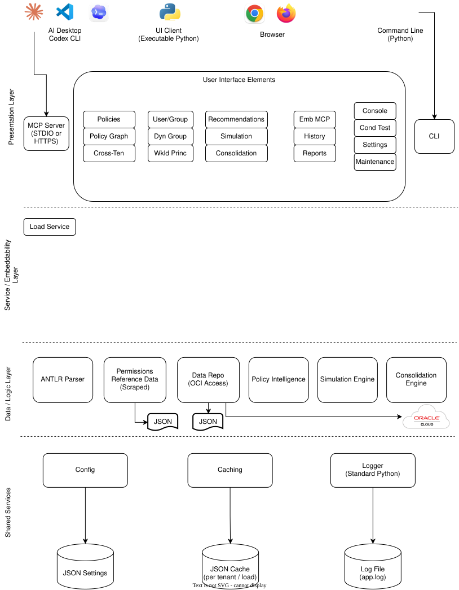
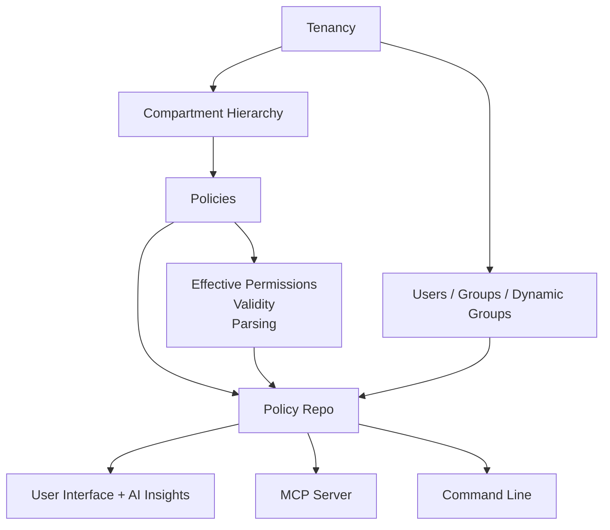
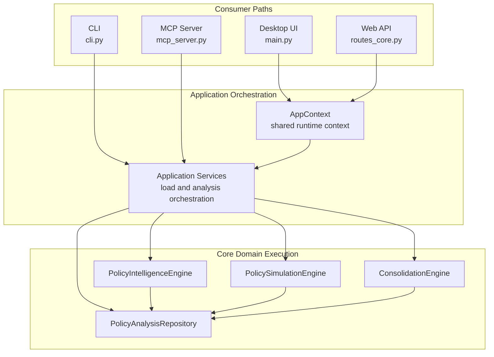
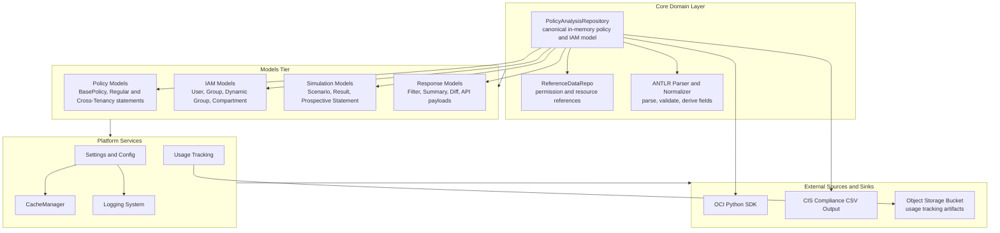
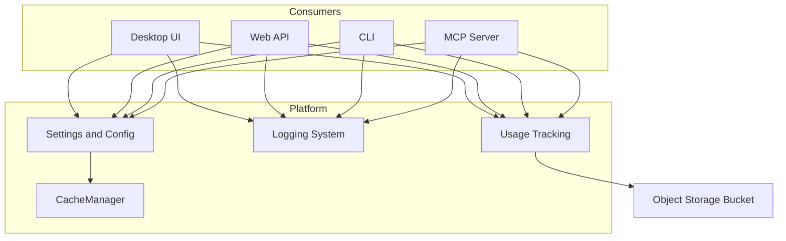

# Architecture

OCI Policy Analysis has four interfaces—desktop, CLI, FastAPI web, and FastMCP—over shared application services, repositories, and analysis engines. The application loads a snapshot of OCI IAM and policy data, retains the original evidence, and derives models for search, reporting, and simulation. These models represent the tool’s understanding of that snapshot; they are not the OCI policy engine and do not make authoritative OCI authorization decisions.

The overview diagram shows the major components:

Presentation code handles interaction and transport. Application services coordinate use cases, while repositories and engines hold and analyze the data. DeepDiff supports comparisons, FastMCP exposes tools to MCP clients, and the official OCI Python SDK supplies live tenancy data. Cache, exported JSON, and CIS compliance output provide alternative input sources with different data coverage.

## Data Model

`PolicyAnalysisRepository` holds the mutable analysis snapshot: compartments, IAM identities, policies, normalized statements, and derived fields. A live load populates it through OCI SDK calls; offline loads populate it from cached/exported data or compliance output. Source statements remain available even when they are invalid, unresolved, or cannot be expanded into permissions.

Post-load enrichment calculates effective paths, principal identities, validation findings, and the derived corpora. Full UI loads also calculate intelligence overlays and permission reports; the minimal profile used by MCP omits the full recommendations workflow. A successful load does not imply complete tenancy coverage. Collection scope, identity-domain search depth, missing data, and source age all affect what can be represented.

## Layers

**Presentation layer**

Desktop Tkinter tabs, the CLI, web routes and JavaScript, and MCP tools adapt user requests to the shared runtime. They format results and manage interaction; the desktop still has some legacy repository/engine orchestration in its main controller.

**Application services layer**

Modules under `application/services/` expose task-oriented operations without depending on Tk widgets or HTTP request objects. `LoadService` coordinates input loading and post-load profiles; analysis and query services filter statements; other services provide simulation, recommendations, settings, caching, and logging. `PolicyGraphService` projects corpus facts into the same graph/search result shape for desktop and web, so the interfaces do not implement separate policy interpretations.

`AppContext` holds the active settings, repositories, engines, corpora, and status used by services. It gives non-desktop consumers reusable application wiring and a shared dataset for related operations. Services may accept the context or a focused dependency such as a corpus. Existing consumers also call repositories and engines directly; the service boundary is the direction for reusable orchestration, rather than a claim that every code path has already migrated.

Python embedding examples, load profiles, and integration guidance belong in [Embedding and Integrating OCI Policy Analysis](core_integration.md).

**Core analysis layer**

Modules under `application/core/` contain the repository, permission reference data, parsers and normalizers, corpus builders, and intelligence, simulation, and consolidation engines. These components derive analysis from the loaded snapshot. Recommendations and simulation results retain their relationship to source policies and data-quality findings.

**Platform support**

Configuration, cache storage, logging, and usage tracking support each consumer. OCI client operations use the official SDK; presentation adapters do not need their own policy grammar or permission expansion logic.

---

## Policy Parsing

OCI policies are parsed using an **ANTLR-based parser** and normalization helpers. Parse trees are converted into structured subjects, verbs, resources, locations, and condition data. Validation combines that structure with the loaded compartment and IAM inventory. Parser support and the bundled permission mappings can lag OCI changes; unsupported or unresolved statements must remain visible as findings rather than being treated as proof that access is absent.

Once a policy statement is parsed, a series of derived fields are computed and added to the internal data model:

- **Effective Path**: Determines which compartments a statement is in scope for, based on the policy's compartment location and referenced locations within statements.
- **Validity & Invalid Reasons**: Checks whether a policy statement is internally consistent and matches the loaded OCI structures (e.g., references to deleted compartments or malformed subjects).
- **Parsed Conditions and Statement Breakdown**: Conditionals (WHERE clauses), operators, and subjects are normalized and attached to the data model for fine-grained filtering and analysis.
- **Policy Overlap**: Using resource-to-permission data, the system computes which statements overlap in their effective permissions, enabling conflict/duplication analysis.
- **Canonical Models**: TypedDict schemas and corpus dataclasses describe the normalized structures used by filtering, UI rendering, and service responses.

Validation describes what the tool can establish from the current input; it is not validation by OCI’s authorization service. Maintainers can see the [logic context](https://github.com/agregory999/oci-policy-analysis/blob/main/context/project/CONTEXT_logic.md) and [policies-tab context](https://github.com/agregory999/oci-policy-analysis/blob/main/context/project/CONTEXT_policies_tab.md) for deeper implementation details.

---

## Policy corpora

The repository preserves the input and its findings. A corpus compiles that input into a stable, shared representation for downstream analysis. This separation lets a policy remain available for diagnosis without contributing unsupported permission facts to reports or search.

### Regular policy corpus

`PolicyCorpusBuilder` creates an immutable, schema-versioned `PolicyCorpus` after effective-path calculation and validation. It is the tool’s best available model of representable policy contributions within the loaded tenancy. Each direct fact records a canonical principal, grant/effective path, expanded permission, allow or deny effect, condition, and provenance back to the policy and original statement. Separate facts preserve contributions from different source statements instead of merging away their evidence.

The builder excludes explicitly invalid statements, missing paths or principals, unsupported effects, and verb/resource combinations without concrete permission expansion. Each exclusion records a reason and source details. “Valid” here means accepted by the tool’s validation and mapping rules, not certified by OCI. A programmatic build before validation can admit a statement whose validity flag is absent, provided the required fields and mappings are available.

The corpus contains both direct facts and effective facts expanded along the loaded compartment hierarchy. Effective facts retain the original grant path and identify inheritance from an ancestor. Conditions and deny contributions remain explicit; compiling or displaying a fact does not mean its condition has been satisfied or that an allow has survived all relevant denies.

The regular corpus is used by:

- **Permissions Analysis and CLI permission exports:** projections of direct and inherited contributions, with exclusions available for diagnosis.
- **Policy Graph in desktop and web:** a common search projection of direct grants, preserving principal, resource/permission, effective path, condition, and source-statement details. It does not render all inherited facts or calculate an authorization decision.
- **Simulation:** shared permission expansion for candidate statements, with prospective statements compiled into a separate overlay. Request matching and condition evaluation remain simulation-engine responsibilities.

This shared model reduces differences between interfaces and avoids re-expanding permissions independently for each view. It supports case-consistent principal identity, traceable reports, and explanations of why statements were omitted. Statement filtering through the repository remains useful for reviewing the complete source snapshot, including statements excluded from the corpus.

### Cross-tenancy corpus

`CrossTenancyCorpus` is a separate immutable snapshot of definitions, cross-tenancy source statements, resolved relationships, findings, and diagnostics. It preserves source occurrences and unresolved evidence, rather than applying the regular corpus’s permission-fact admission rules. Its shared projection supplies desktop and web cross-tenancy analysis views. Matching names in different tenancies remain distinct ownership scopes.

A relationship derived from local cross-tenancy statements does not establish that the remote tenancy has supplied the matching policy or that OCI will authorize a request.

### Lifecycle and interpretation

Loads reset derived state and rebuild the corpora from the active repository. The shared post-load pipeline performs this work for non-desktop consumers; the desktop controller builds the corresponding models during its post-load flow. Regular corpus build timestamps and schema versions describe the compiled model, not a live OCI refresh. Prospective overlays do not change policies in OCI.

Neither corpus replaces OCI’s policy engine. Results depend on the input snapshot, collection scope, available identity data, permission reference mappings, and supported syntax. An omitted or unmatched grant can reflect incomplete coverage or an exclusion. A conditional grant requires request context, and effective access may depend on other policy contributions. Use the model as analysis evidence and verify actual access through OCI where an authoritative decision is needed.

---

## Caching

The application caches repository snapshots and supported derived analysis fields as versioned JSON files. Their contents depend on the source and load profile; a policy-only compliance snapshot does not contain the same IAM inventory as a live tenancy load. Caching serves to:
- Accelerate reloads (especially when analyzing large tenancies or when OCI credentials are not immediately available)
- Support offline/remote diagnostics or hand-offs
- Provide input for diff/historical comparison functionality

Caches preserve the collected snapshot, not a continuing connection to OCI. Reloading runs the selected post-load enrichment and rebuilds the corpora. Workflows that require missing identity or tenancy data may be unavailable or have limited results; cached analysis remains subject to its collection time and scope.

Cache management includes import, export, snapshotting, refreshing, and selection of caches—all directly exposed via the Settings Tab. Maintainers can see the [data repository context](https://github.com/agregory999/oci-policy-analysis/blob/main/context/project/CONTEXT_data_repo.md) and [settings context](https://github.com/agregory999/oci-policy-analysis/blob/main/context/project/CONTEXT_settings_tab.md) for more details.

---

## Settings

A robust and extensible settings system governs configuration for all areas of the application. Settings management covers:
- Tenancy/OCI configuration (profile, session token, compartment selection, recursion, MCP server config)
- Desktop-only preview controls, including [Optional AI Assist](optional_ai_assist.md)
- UI preferences (font size, tab visibility, context help, advanced tab enablement)
- Cache import/export, refresh, and selection
- Application-wide toggles for maintenance/debug features

Settings are saved and loaded automatically to persistent storage, enabling reproducibility between sessions. The settings system ensures all tabs receive relevant configuration updates dynamically, leveraging a propagation mechanism orchestrated by the main UI controller.

See the [settings maintainer context](https://github.com/agregory999/oci-policy-analysis/blob/main/context/project/CONTEXT_settings_tab.md) for the full field-by-field design.

---

## Logging

Logging is centrally managed by a flexible, unified system supporting global and per-component log levels, controlled both at startup and dynamically via the Console Tab UI.
Key characteristics:
- Records admitted by the configured log levels go to shell output and a rotating application logfile; packaged applications may have no visible shell.
- In-app Console Tab shows INFO+ logs for all components, while the shell and log file can include DEBUG-level output per logger.
- Log level selection is fully dynamic, can target individual loggers, and is instantly persisted for the next session.
- Special modes (like CLI `--verbose`) override all levels and pin logging for troubleshooting.
- ConsoleTab UI cannot enable global DEBUG logging, only component-level.

See the [logging maintainer context](https://github.com/agregory999/oci-policy-analysis/blob/main/context/project/CONTEXT_logging.md) for architecture diagrams, detailed workflows, and UI patterns.

---

## Maintainer context

The detailed feature and subsystem corpus is maintained separately from the
published documentation. Start at the [maintainer context index](https://github.com/agregory999/oci-policy-analysis/blob/main/context/README.md).

---

## Core Runtime Architecture (4 Consumer Paths)

The codebase exposes a shared core through four primary consumer paths:
- **Desktop UI** (`main.py` / Tkinter tabs)
- **CLI** (`cli.py`)
- **Web API** (`presentation/web/api/routes_core.py` via FastAPI dependencies)
- **MCP Server** (`mcp_server.py` via FastMCP)

Each path ultimately converges on shared repository and engine components, with the OCI SDK and platform support beneath the core domain. The following diagrams summarize logical responsibilities; they are not a strict import dependency graph. The corpus builders and projections described above extend this overview.

### Runtime Flow (Consumers to Engines)

### Logical Layering (Domain, Models, Platform, External)

### Cross-Cutting Operations (Settings, Logging, Usage)

## Canonical principal identity

Named principal keys are case-folded to lowercase, including domain and identity names (for example `group:lz092026/opsteam`). Corpus construction also normalizes older mixed-case keys, so case variants share one graph node and permission identity. Exact filters and simulation accept either spelling. Subject/display fields and source statement text preserve their original spelling; normalization does not rewrite policy text. Opaque OCIDs, resource identifiers and condition-derived workload payloads retain their values. Cross-tenancy ownership remains a separate scope, so matching names in different tenancies do not become the same principal.

## Optional Qt presentation

The exploratory `presentation.qt` adapter composes independent overview/settings,
policy-browser, policy-graph, dynamic-group, resource-principal, and MCP/assistant pages in a navigation shell, with a separate
INFO+ log/load-activity dock.
`WorkbenchController` owns the current context and serializes background loads;
a worker constructs a fresh context for each attempt and publishes it only after
`LoadService` succeeds. Pages rebind to the current context after publication.
Only Overview is enabled before the first successful load; failed reloads retain
the current snapshot and available navigation.
Filtering and graph projection call `AnalysisService` and `PolicyGraphService`.
Dynamic-group inventory uses repository filters, and selected groups query
`PrincipalAnalysisService.by_exact_dynamic_groups`. The resource-principal page
uses that same service for broad subjects, resource constraints and OKE workload
selectors, preserving match confidence and residual evidence. Shared Qt tables retain source
records behind proxy sorting; an explicit context-menu action opens a reusable
right-side drawer that displays all fields
without interpreting or modifying the snapshot.
Qt scene items, tables, logging controls, and queued UI log delivery stay in the
presentation layer. Shared Qt palettes cover widgets and graph items; appearance
and logging preferences use the existing settings storage. OCI, named-cache,
exported-snapshot, and CIS loads all publish through the same worker lifecycle.
Embedded MCP pins a successful context with request-local binding, reuses the
existing query tool schemas, and excludes data mutation/reload tools. Its owned
listener locks loading until shutdown. The optional Codex adapter uses a child
process and native JSONL streaming; model turns require explicit Send.
The core has no PySide6 dependency. See
[Qt integration and scope](core_integration.md#qt-desktop-exploration) for the
current comparison with Tkinter and the remaining lifecycle limitations.

The Qt presentation's `ExperienceMode` owns the saved Standard/Advanced display
preference. Navigation access is declared in `page_specs`, while individual
widgets/tabs register with the mode object. The mode does not authorize domain
operations or modify the loaded snapshot. Checked tables use native model roles
and stable adapter-supplied IDs; inclusion state stays outside source records.
Workflow pages send explicit selected IDs to shared services, never infer policy
eligibility or trigger persistent operations from selection-change signals.

### Qt prospective workspace

The Qt prospective page binds `ProspectiveWorkbenchService` to each newly loaded
context. It reuses the tenancy-scoped `ProspectiveStatementsService` and standalone
prospects cache, hydrates simulation on load without saving, and uses
`ProspectiveBuilderService` for guided previews. Modal drafts remain local until
Save. Successful saves refresh browser and graph projections; Standard mode uses
only collected sources, while Advanced mode includes labelled what-if evidence.
Invalid prospects remain browser evidence and appear as graph corpus exclusions.
Potential-risk scoring runs against a detached statement and repository view,
leaving collected sources and the active intelligence overlay unchanged. This is
heuristic analysis of snapshot evidence, not an OCI authorization decision.

The combined-cache format is unchanged (`version: 2`, `schema_version: 3`);
prospects remain in their existing separate tenancy files. No data migration is
required. Interactive saves opt into persistence-error propagation so failures
are visible instead of being reported as successful saves.

The Qt graph's related-statement table uses
`PolicyGraphService.get_statement_evidence` to join selected combinations to
current source records and direct corpus facts, across graph pagination. The
returned records are detached copies and retain conditions and provenance. The
shared details drawer exposes the complete source plus these permission facts;
Standard mode uses the collected corpus only. Graph selections are not evaluated
OCI decisions. Collection time is displayed once in the app's status-bar footer.

### Qt condition tester

The Tools condition tester uses `ConditionTesterService.parse_clause` to normalize
handoffs, validate syntax and discover variables on both sides of predicates.
`parse_condition_structure` captures lexer and parser diagnostics before the UI
creates input fields. The same evaluator as simulation handles supplied values
and nulls; missing RHS variable references fail comparisons, including inequality
and list references. This is a runtime semantic correction with no stored-field
or cache-format change, so no migration is required.

Shared Qt record tables emit an explicit condition-test handoff. The shell opens
the tester and clears previous inputs, while expression/value edits invalidate
stale results. Testing remains available without tenancy data, never mutates the
snapshot and does not authorize OCI requests. Test cases are session-local and are not saved to settings or caches.

### Simulation execution and assistance

Qt's SimulationController owns preparation/execution/suggestion workers and uses
the shell mutation gate to serialize them with loads, prospective editing and
embedded MCP. SimulationService resolves candidates on detached source copies;
SimulationWorkbenchService validates explicit inclusion before running the active
engine, then attaches original request evidence to the runtime history entry.
Statement traces expose stable source IDs and provenance through additive fields.
The engine's legacy result and history APIs remain compatible.

Related scenarios always resolve a valid catalog operation and require a separate
effective compartment choice and statement preparation. Reverse permission
mapping belongs in SimulationWorkbenchService: bundled catalog mappings determine
permission/resource/family candidates, and corpus facts supply scoped source
examples. Parser validation does not establish an OCI decision. Only explicit
review/save uses the existing prospective persistence service. Repreparation
preserves the original selection plus newly eligible what-if rows. Snapshot
replacement clears runtime history and its identity token; no reports, suggestion
state or tokens enter combined-cache serialization. No cache migration is needed.

### Qt report execution

Tools → Reports delegates to `ReportsService` through a retained `ReportWorker`.
The shell serializes report analysis with loads, simulation, prospective edits
and embedded MCP, and waits for worker completion before closing. Worker results
are detached from the snapshot and discarded if their context was replaced.
The shared service owns report choices and JSON/Markdown/portable HTML export;
Qt owns file dialogs and palette-aware, resource-blocked rich-text previews.
The permissions report is a Full-profile prerequisite; supersession consumes
existing findings, while Full Overlaps explicitly refreshes derived overlap data.

The Qt Recommendations page reads `RecommendationsService` without fetching
missing live limits during display. Explicit Run analysis calls its
`refresh_analysis` method on a retained worker, using the shared full post-load
pipeline. The shell serializes access against loads, MCP, reports, prospective
edits and simulation. Rebinding drops old simulation results and report previews;
prospective statements and their CRUD manager are retargeted to the replacement
engine. Enrichment failures can be partial and are surfaced rather than treated
as complete results. Supersession detail shaping separates unconditional coverage
from conditional review evidence in the shared service; Qt only renders it.
