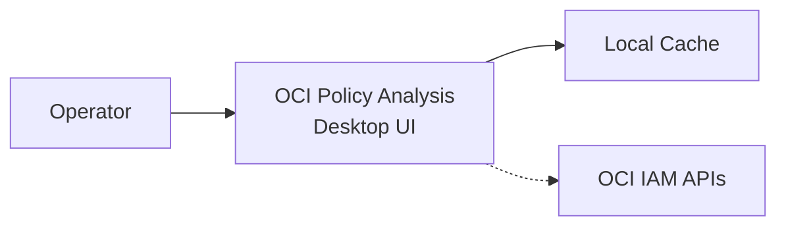
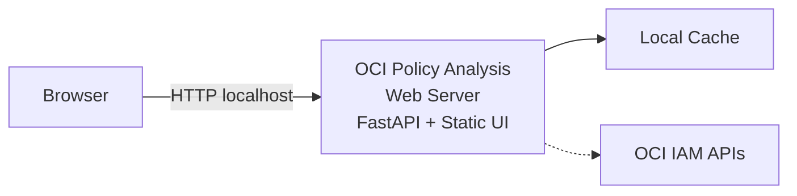
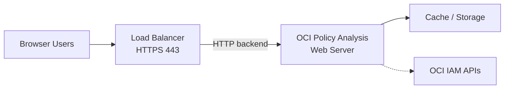

# Overview

**OCI Policy Analysis** is now a **multi-modal application** for Oracle Cloud Infrastructure (OCI) IAM analysis. You can run it as:

- a **Desktop UI** (MacOS or Windows executable)
- a **Web UI** (FastAPI + static web client)
- a **CLI** for automation and offline workflows
- an **MCP Server** for AI tooling integrations (Claude, VS Code MCP, etc.)
- **Embedded** as the tool's core functionality inside other programs

The core goal across all modes is the same: analyze and explain OCI IAM policies, dynamic groups, principals, and effective access. You can load data directly from OCI, reuse a local combined cache, or import OCI CIS Compliance output when the tool must not connect to a tenancy.

## Core Capabilities

- **Policy Analysis**: Parse/filter IAM policy statements by subject, verb, resource, compartment, and conditions.
- **Dynamic Group Analysis**: Review dynamic-group rules, usage, and related policy grants.
- **User & Group Analysis**: Policy details based on group or user view
- **Principal-Centric Analysis**: Analyze access for users, groups, resource principals, and OKE workload identities.
- **Historical Comparison**: Compare policy snapshots over time.
- **Cross-tenancy Policies**: Analysis of cross-tenancy details with remotely defined tenancies
- **Caching**: Save/load combined tenancy data for repeatable, offline, or remote workflows.
- **Recommendations Workbench**: Catalog and prioritize policy improvement suggestions.
- **Export & Import**: Export analysis data to JSON/CSV and re-import as needed.
- **Contextual Help**: In-app guidance based on page/section context.

## Advanced Capabilities

- **Condition Tester**: Evaluate hypothetical where-clause values.
- **Permissions Report**: Resolve effective OCI permissions by principal and compartment.
- **MCP Tooling**: Expose tenancy data as MCP tools/resources for AI assistants.
- **API Simulation**: Evaluate whether an OCI API call should be allowed under selected policies.
- **Consolidation Workbench**: Suggest consolidation or moves of policy statements with monitoring of execution.

The application supports **Instance Principal**, **OCI profile/config**, and **Session Token** authentication models. For container deployments, it also can utilize **Resource Principal** authentication.

## Feature Availability Matrix (by Startup Mode)

> This is a living matrix and can be updated as parity evolves.

| Capability | Desktop | Web | CLI | MCP |
|---|---|---|---|---|
| Live OCI data | ✅ | ✅ | ✅ | ✅ |
| Combined cache | ✅ | ✅ | ✅ | ✅ |
| CIS data import | ✅ | ✅ | ✅ | ❌ |
| Interactive UI | ✅ | ✅ | ❌ | ❌ |
| Policy search | ✅ | ✅ | ⚠️ | ✅ |
| Historical comparison | ✅ | ✅ | ❌ | ⚠️ |
| Prospective editor | ✅ | ✅ | ❌ | ⚠️ |
| Recommendations | ✅ | ✅ | ❌ | ❌ |
| Permissions report | ✅ | ✅ | ⚠️ | ❌ |
| API simulation | ✅ | ✅ | ❌ | ✅ |
| Consolidation | ✅ | ✅ | ❌ | ❌ |
| AI/MCP integration | ✅ | ⚠️ | ⚠️ | ✅ |
| Human analysis | ✅ | ✅ | ❌ | ❌ |
| Team analysis | ✅ | ✅ | ⚠️ | ⚠️ |
| Automation | ⚠️ | ⚠️ | ✅ | ✅ |

**Legend**
- ✅ Fully supported
- ⚠️ Partial/in progress
- ❌ Not intended for that mode

**Notes**

- The CLI imports OCI CIS Compliance CSV output with `--load-from-compliance`; it does not provide an interactive UI.
- MCP capabilities are exposed through tool calls. The desktop app includes an embedded MCP server; web and CLI can use MCP indirectly.
- The CLI permissions report is export-only. See the mode-specific guides for supported options and workflows.

## Run Modes (Architecture-at-a-Glance)

The following simplified diagrams show common deployment/run patterns.

### 1) Desktop Mode (Executable or Python Env)

### 2) Web Mode (Python Env)

### 3) Web Mode (Container/Server + Load Balancer)

### 4) MCP Mode

MCP usage patterns (STDIO, HTTP, embedded vs standalone) are documented in detail on the dedicated [MCP Server](mcp.md) page.

### 5) Embedded

See [Integration](core_integration.md).  In this mode, you build another application around OCI Policy Analysis, and use the core functionality to provide details needed for the surrounding app.

An example of this could be an OCI Function that generates a daily report.
